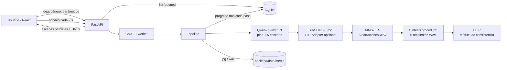

# Informe técnico — Storybook

**Proyecto Integrador IA Generativa · Generación local de cuentos ilustrados con narración y ambientación sonora**
Universidad Santo Tomás, Seccional Tunja · Ingeniería de Sistemas · Electiva Ingeniería Aplicada — IA Generativa

> Exportar a PDF: `pandoc INFORME_TECNICO.md -o informe.pdf` (o abrir en VS Code / Typora).
> Las secciones marcadas **[COMPLETAR]** requieren datos medidos por el equipo en su propio hardware.

## 1. Problema y objetivo
Crear cuentos multimodales coherentes (texto, imagen, voz y sonido) suele depender de servicios en la nube: costo, internet y
exposición de los datos. **Objetivo:** una aplicación que, dada una idea y un género, genere **siempre cinco escenas** con texto
pertinente, ilustración original, narración sintetizada y al menos un ambiente sonoro distinto de la voz, **ejecutando todos los
modelos localmente** y manteniendo continuidad narrativa y visual verificable.

## 2. Arquitectura y flujo de datos

- **Frontend (React + Tailwind):** creación, lector con reproducción, biblioteca, experimentos, arquitectura.
- **Backend (FastAPI):** autenticación JWT, cola de un solo *worker* (evita dos modelos grandes en memoria), persistencia del
  avance en SQLite, medios estáticos, PDF y enlaces públicos.
- **Motor (`backend/engine`):** un módulo por modalidad. `pipeline.generate()` no conoce la base de datos: informa el avance
  mediante un callback, por lo que el mismo código sirve a la API y al script de experimentos.
- **Transferencia de información entre componentes:** el LLM produce una *biblia* (título, protagonista ES/EN, escenario EN);
  cada escena devuelve `TEXTO`, `IMAGEN_EN` y `SONIDO`. `IMAGEN_EN` + biblia + estilo del género forman el prompt de imagen;
  `TEXTO` alimenta el TTS; `SONIDO` selecciona el ambiente. Cada paso se guarda en la fila del cuento.
- **Memoria:** entre fases se descargan los modelos (salvo GPU ≥ 22 GB), de modo que una GPU de 8–12 GB basta.

## 3. Tecnologías y justificación
| Componente | Elección | Justificación | Alternativas |
|---|---|---|---|
| LLM | Qwen2.5 1.5B / 3B / 7B-Instruct | Buen español, sigue formatos, tres tamaños según hardware | Llama-3.2 (licencia restrictiva), Phi-3.5 (español más débil) |
| Imagen | SD-Turbo / SDXL-Turbo | Destilación adversarial: 1–4 pasos, viable en CPU y rápida en GPU | SD 1.5 (25+ pasos), FLUX.1-schnell (VRAM alta) |
| Identidad | IP-Adapter SDXL | Condiciona por imagen de referencia sin entrenar | LoRA por personaje (requiere entrenamiento) |
| Voz | MMS-TTS spa (VITS) | Español nativo, ligero, funciona en CPU | Coqui XTTS (pesado), Piper |
| Ambiente | DSP procedural NumPy/SciPy | Determinista, sin licencias, ligero, *loop* continuo | AudioLDM2 / MusicGen (más pesados, licencias NC) |
| Métrica | CLIP ViT-B/32 | Estándar para similitud visual; solo mide | LPIPS, DINOv2 |
| Persistencia | SQLite | Cero instalación → reproducibilidad | MongoDB, PostgreSQL |

## 4. Procedimiento de generación de las cinco escenas
1. **Plan:** `TITULO`, `PROTAGONISTA`, `PROTAGONISTA_EN`, `ESCENARIO_EN`, con *parser* tolerante (markdown, acentos, multilínea).
2. **Escenas 1–5:** la idea del usuario se repite como premisa obligatoria en cada prompt. Se instruye al modelo a conservar
   protagonista, papeles y conflicto, y a usar el género como tono (no como sustituto de la idea). El prompt también incluye
   biblia, **todas las escenas anteriores** y el acto del arco (inicio, desarrollo,
   conflicto, clímax, desenlace). Salida: `TEXTO` (70–110 palabras), `IMAGEN_EN`, `SONIDO` (lista cerrada de 12, validada).
   Protecciones contra la degeneración de modelos pequeños: `sanitize_scene` (corta listas de etiquetas y frases truncadas),
   extensión si hay menos de 55 palabras y un reintento con otra semilla si quedan menos de 35.
3. **Ilustración:** `estilo_del_género + IMAGEN_EN + protagonista_EN + escenario_EN`, semilla distinta y reproducible por escena,
   `guidance_scale=0`
   (requisito de los modelos Turbo). Con IP-Adapter la escena 1 define la referencia para las escenas 2–5 (escala 0,6).
4. **Voz:** oraciones sintetizadas con semilla fija, unidas con pausas de 0,28 s y normalizadas.
5. **Ambiente:** efecto de la escena + capa base del género al 30 %, *crossfade* para bucle continuo (≈ 18,5 s).
6. **Medición:** similitud coseno CLIP entre las cinco ilustraciones (`clip_mean`, `clip_min`, `clip_vs_first`).

## 5. Estrategia de consistencia
| Nivel | Técnica |
|---|---|
| Narrativa | Biblia del personaje + contexto acumulado + arco de 5 actos |
| Visual | Estilo fijo por género, descripción del protagonista en cada prompt, semillas distintas reproducibles, IP-Adapter (perfil calidad) |
| Sonora | Capa base común al género + efecto específico por escena; misma voz y velocidad |
| Verificación | Menciones del protagonista (0–5) y similitud CLIP; revisión visual con hoja de contacto |

## 6. Configuraciones y experimentos
Estrategias comparadas (misma idea, género, semilla base y secuencia de semillas de imagen): **off** (sin biblia ni contexto),
**on** (biblia + contexto) y **ip** (on + IP-Adapter, perfil calidad). Cada escena usa una semilla de imagen distinta y reproducible;
la secuencia es idéntica entre estrategias para que la comparación no confunda el efecto de la consistencia con el ruido inicial.
Se ejecutan con `scripts/run_experiments.py`, que guarda
hojas de contacto, `resultados.csv` y `resultados.md`. El panel web también permite lanzar una pareja **ON/OFF** con la misma
idea, género, perfil y semilla, y revisar las cinco ilustraciones, CLIP y los tiempos de ambas ejecuciones.

El lector incorpora un taller por escena: permite editar y guardar el texto, conservar hasta 20 versiones anteriores,
restaurarlas y volver a sintetizar la narración sin regenerar las demás escenas. La edición no cambia automáticamente la
ilustración ni el audio existente; la interfaz indica cuándo la narración quedó desactualizada.

**Hardware y software de las pruebas — [COMPLETAR]** (salida de `python scripts/hardware_report.py`):

| Elemento | Valor |
|---|---|
| CPU / RAM / GPU | |
| Sistema operativo / Python / PyTorch | |
| transformers / diffusers | |

**Resultados — [COMPLETAR con `resultados.md`]:**
| Género | Estrategia | Perfil | Total (s) | Imagen (s) | Menciones | CLIP medio | CLIP mín |
|---|---|---|---|---|---|---|---|
| | | | | | | | |

**Referencia medida en el entorno de desarrollo** (CPU de 2 núcleos, sin GPU, perfil ligero, una sola corrida): texto 1110 s,
imágenes ≈ 73 s c/u, voz ≈ 38 s c/u, total 1668 s; ≈ 1 token/s con Qwen2.5-1.5B en float32. En esa CPU bfloat16 fue ≈ 3× más lento
que float32, por lo que se usa float32 en CPU y float16 en GPU. Estos números **no** representan una GPU NVIDIA.

## 7. Evidencia de pruebas
- Pruebas automáticas (`backend/tests`): parser y saneado de texto, configuración, prompts, 12 ambientes (silencio y bucle),
  métrica CLIP, base de datos, PDF con caracteres especiales y API (registro, aislamiento entre usuarios, validación, favoritos, borrado).
- Tres pruebas con combinaciones distintas de idea/género y capturas de las cinco escenas: **[COMPLETAR]** (`docs/evidencias/`).
- Comprobación de ejecución sin red con `HF_HUB_OFFLINE=1`: **[COMPLETAR]**.
- Fallos detectados y cambios realizados: **[COMPLETAR]** (ver fallos conocidos abajo como punto de partida).

## 8. Resultados, limitaciones y consideraciones éticas
**Limitaciones:** los modelos de texto pequeños pueden repetir frases o mezclar idiomas; los modelos Turbo no garantizan identidad
exacta entre escenas (IP-Adapter la mejora pero no la asegura); MMS-TTS tiene una voz y prosodia limitada y no lee cifras; en CPU el
tiempo es alto. **Fallos conocidos de versiones previas, ya corregidos:** escena con lista de etiquetas en mayúsculas (saneado),
error de dimensiones en el ambiente «caja musical», PDF roto por caracteres `&`/`<` en títulos.
**Mejoras futuras:** voces por personaje (Piper), edición de texto con re-narración, LoRA por personaje, cuantización GGUF para CPU.
**Ética:** procesamiento local (privacidad), aviso de contenido generado por IA en el lector y el PDF, posibles sesgos, respeto de
licencias no comerciales, sin clonación de voces de personas reales.

## 9. Licencias y derechos de voz/audio
| Recurso | Licencia | Uso |
|---|---|---|
| Qwen2.5-1.5B / 7B-Instruct | Apache 2.0 | Académico y comercial |
| Qwen2.5-3B-Instruct | Qwen Research | No comercial |
| SD-Turbo / SDXL-Turbo | Stability AI Community | Investigación / no comercial |
| IP-Adapter (h94) | Apache 2.0 | Académico y comercial |
| CLIP ViT-B/32 (OpenAI) | MIT | Académico y comercial |
| MMS-TTS spa (Meta) | CC BY-NC 4.0 | No comercial, con atribución |
| Ambientes procedurales | Código del proyecto | Sin restricciones |
| Código de la aplicación | MIT | — |

Verifica cada licencia en la ficha del modelo antes de entregar. No se redistribuyen pesos: se descargan con `scripts/download_models.py`.
