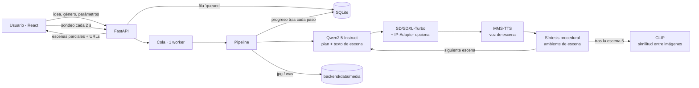

# Informe técnico — Storybook

**Proyecto Integrador IA Generativa · Generación local de cuentos ilustrados con narración y ambientación sonora**
Universidad Santo Tomás, Seccional Tunja · Ingeniería de Sistemas · Electiva Ingeniería Aplicada — IA Generativa

> Exportar a PDF: `pandoc INFORME_TECNICO.md -o informe.pdf` (o abrir en VS Code / Typora).
> Los datos de generación deben medirse en el equipo de la exposición. No se presentan estimaciones como resultados experimentales.

## 1. Problema y objetivo
Crear cuentos multimodales coherentes (texto, imagen, voz y sonido) suele depender de servicios en la nube: costo, internet y
exposición de los datos. **Objetivo:** una aplicación que, dada una idea y un género, genere cinco escenas cuando el proceso
finaliza correctamente, con texto, ilustración, narración sintetizada y ambiente sonoro. Tras descargar los pesos, la inferencia
está diseñada para ejecutarse en el equipo local; la continuidad narrativa y visual se busca y se evalúa con indicadores
exploratorios, pero no se garantiza.

## 2. Arquitectura y flujo de datos

- **Frontend (React + Tailwind):** creación, lector con reproducción, biblioteca, experimentos, arquitectura.
- **Backend (FastAPI):** autenticación JWT, cola de un solo *worker* (evita dos modelos grandes en memoria), persistencia del
  avance en SQLite, medios estáticos, PDF y enlaces públicos.
- **Motor (`backend/engine`):** un módulo por modalidad. `pipeline.generate()` no conoce la base de datos: informa el avance
  mediante un callback, por lo que el mismo código sirve a la API y al script de experimentos.
- **Transferencia de información entre componentes:** el LLM produce una *biblia* (título, protagonista ES/EN, escenario EN);
  cada escena devuelve `TEXTO`, `IMAGEN_EN` y `SONIDO`. `IMAGEN_EN` + biblia + estilo del género forman el prompt de imagen;
  `TEXTO` alimenta el TTS; `SONIDO` selecciona el ambiente. Cada paso se guarda en la fila del cuento.
- **Orden real del pipeline:** después del plan, se procesa cada escena en secuencia (texto → imagen → voz → ambiente) antes
  de pasar a la siguiente; CLIP se ejecuta al final.
- **Memoria:** entre fases se descargan los modelos (salvo GPU ≥ 22 GB), de modo que una GPU de 8–12 GB basta.

## 3. Tecnologías y justificación
| Componente | Elección | Justificación | Alternativas |
|---|---|---|---|
| LLM | Qwen2.5 1.5B / 3B / 7B-Instruct | Buen español, sigue formatos, tres tamaños según hardware | Llama-3.2 (licencia restrictiva), Phi-3.5 (español más débil) |
| Imagen | SD-Turbo / SDXL-Turbo | Destilación adversarial: 1–4 pasos, viable en CPU y rápida en GPU | SD 1.5 (25+ pasos), FLUX.1-schnell (VRAM alta) |
| Identidad | IP-Adapter SDXL | Condiciona por imagen de referencia sin entrenar | LoRA por personaje (requiere entrenamiento) |
| Voz | MMS-TTS spa (VITS) | Español nativo, ligero, funciona en CPU | Coqui XTTS (pesado), Piper |
| Ambiente | DSP procedural NumPy/SciPy | Determinista, sin licencias, ligero, *loop* continuo | AudioLDM2 / MusicGen (más pesados, licencias NC) |
| Métrica | CLIP ViT-B/32 | Estándar para similitud visual; solo mide | LPIPS, DINOv2 |
| Persistencia | SQLite | Cero instalación → reproducibilidad | MongoDB, PostgreSQL |

## 4. Procedimiento de generación de las cinco escenas
1. **Plan:** `TITULO`, `PROTAGONISTA`, `PROTAGONISTA_EN`, `ESCENARIO_EN`, con *parser* tolerante (markdown, acentos, multilínea).
2. **Escenas 1–5:** la idea del usuario se repite como premisa obligatoria en cada prompt. Se instruye al modelo a conservar
   protagonista, papeles y conflicto, y a usar el género como tono (no como sustituto de la idea). El prompt también incluye
   biblia, **todas las escenas anteriores** y el acto del arco (inicio, desarrollo,
   conflicto, clímax, desenlace). Salida: `TEXTO` (objetivo 70–110 palabras, no garantizado), `IMAGEN_EN`, `SONIDO`
   (lista cerrada de 12, validada). Protecciones contra la degeneración de modelos pequeños: `sanitize_scene` (corta listas
   de etiquetas y limita a 140 palabras), extensión si hay menos de 55 palabras y un reintento con otra semilla si la escena
   sigue corta o contiene mayúsculas sostenidas. Si tras el reintento quedan menos de 35 palabras o persisten las mayúsculas,
   la generación falla explícitamente.
3. **Ilustración:** `estilo_del_género + IMAGEN_EN + protagonista_EN + escenario_EN`, semilla distinta y reproducible por escena
   (`semilla_base + 1000 × índice_de_escena`, con índice de 1 a 5),
   `guidance_scale=0`
   (requisito de los modelos Turbo). Con IP-Adapter la escena 1 define la referencia para las escenas 2–5 (escala 0,6).
4. **Voz:** oraciones sintetizadas con semilla fija, unidas con pausas de 0,28 s y normalizadas.
5. **Ambiente:** efecto de la escena + capa base del género al 30 %, *crossfade* para bucle continuo (≈ 18,5 s).
6. **Medición:** similitud coseno entre embeddings de imagen CLIP para los diez pares de ilustraciones (`clip_mean`,
   `clip_min`, `clip_vs_first`). Es una medida exploratoria de similitud visual/semántica: no verifica por sí sola la identidad
   del personaje ni la calidad narrativa.

## 5. Estrategia de consistencia
| Nivel | Técnica |
|---|---|
| Narrativa | Biblia del personaje + contexto acumulado + arco de 5 actos |
| Visual | Estilo fijo por género, descripción del protagonista en cada prompt, semillas distintas reproducibles, IP-Adapter (perfil calidad) |
| Sonora | Capa base común al género + efecto específico por escena; misma voz y velocidad |
| Verificación | Coincidencia léxica aproximada del nombre (0–5), similitud CLIP y revisión humana con hoja de contacto; ninguno garantiza identidad |

## 6. Configuraciones y experimentos
Estrategias comparadas (misma idea, género, semilla base y secuencia de semillas de imagen): **off** (sin biblia ni contexto),
**on** (biblia + contexto) y **ip** (on + IP-Adapter, perfil calidad). Cada escena usa una semilla de imagen distinta y reproducible;
la secuencia es idéntica entre estrategias para que la comparación no confunda el efecto de la consistencia con el ruido inicial.
Se ejecutan con `scripts/run_experiments.py`, que guarda
hojas de contacto, `resultados.csv` y `resultados.md`. El panel web también permite lanzar una pareja **ON/OFF** con la misma
idea, género, perfil y semilla, y revisar las cinco ilustraciones, CLIP y los tiempos de ambas ejecuciones.
Cada comparación ON/OFF del panel es un único par; sirve como demostración controlada, no como evidencia estadística de que
una estrategia siempre sea superior. El script permite ejecutar tres ideas/géneros y guardar seis corridas (OFF/ON), pero no
repite cada condición con varias semillas.

Para generar la evidencia desde la raíz del repositorio en este equipo CPU:
`python backend/scripts/run_experiments.py --profile ligero --strategies off on --combos 3 --seed 42`.
La corrida puede tardar bastante; no se deben interrumpir procesos para presentar resultados parciales como completos.

El lector incorpora un taller por escena: permite editar y guardar el texto, conservar hasta 20 versiones anteriores,
restaurarlas y volver a sintetizar la narración sin regenerar las demás escenas. La edición no cambia automáticamente la
ilustración ni el audio existente; la interfaz indica cuándo la narración quedó desactualizada.

**Hardware y software inspeccionados en el entorno virtual del proyecto (14-11-2026):** estos datos describen el equipo, no una prueba de generación.

| Elemento | Valor |
|---|---|
| CPU / RAM | AMD Ryzen 7 7730U · 16 hilos / 16.5 GB |
| GPU | AMD Radeon(TM) Graphics · 512 MB reportados por Windows; sin GPU NVIDIA/CUDA disponible |
| Sistema operativo / Python | Windows 11 · Python 3.12.10 |
| PyTorch / CUDA | PyTorch 2.5.1+cu121 · CUDA 12.1 en el paquete; sin GPU CUDA disponible |
| transformers / diffusers / accelerate | 4.46.3 / 0.31.0 / 1.1.1 |
| huggingface_hub / FastAPI / reportlab | 0.26.5 / 0.110.1 / 5.1.0 |
| Modelos requeridos en caché | Qwen2.5-1.5B, SD-Turbo, MMS-TTS spa y CLIP detectados |

**Corrida ON/OFF con ajuste de prompts** (`docs/evidencias/20261116_174115/`): una idea, semilla base 42, perfil `ligero`,
CPU, `HF_HUB_OFFLINE=1`. Ambos cuentos completaron las cinco escenas, ilustraciones, voz, ambiente y métrica CLIP. Los prompts
de imagen se ajustaron al límite antes de inferencia; los `story.json` guardan el prompt efectivo, verificado con el tokenizador
SD-Turbo local. La corrida expuso una escena ON incoherente y en mayúsculas; el filtro/reintento documentado abajo se añadió
después de esta corrida, por lo que estos resultados no validan todavía esa protección.

| Género | Estrategia | Perfil | Total (s) | Imagen (s) | Menciones léxicas (de 5) | Promedio palabras/escena | CLIP medio | CLIP mín |
|---|---|---|---:|---:|---:|---:|---:|---:|
| Fantasía | OFF | ligero / CPU | 1071.39 | 146.2 | 2 | 76.0 | 0.8418 | 0.7371 |
| Fantasía | ON | ligero / CPU | 1352.47 | 155.3 | 4 | 62.6 | 0.8505 | 0.7907 |

Con este único par, ON tuvo 4/5 menciones léxicas frente a 2/5, CLIP medio 0.8505 frente a 0.8418 y tardó 281.08 s más.
No se puede atribuir causalidad ni concluir que ON sea mejor. En OFF, la primera escena cambia el nombre y rasgos del personaje
del plan; en ON, la tercera escena fue texto degradado en mayúsculas y no debe presentarse como cuento satisfactorio. Las palabras
por escena fueron `[85, 61, 58, 59, 117]` en OFF y `[75, 59, 43, 61, 75]` en ON: el objetivo de 70–110 palabras no se cumple
en todas las escenas. En ON, los cinco prompts registrados tienen 75 tokens sin tokens especiales (77 con BOS/EOS); OFF tiene
como máximo 75. En ON se conserva el prefijo del personaje. La comparación anterior (`20261114_231700`) queda como antecedente
previo al ajuste y no se mezcla con estos resultados.

## 7. Evidencia de pruebas
- Pruebas automáticas (`backend/tests`): parser y saneado de texto, configuración, prompts, 12 ambientes (silencio y bucle),
  métrica CLIP, base de datos, PDF con caracteres especiales y API (registro, aislamiento entre usuarios, validación, favoritos, borrado).
- Validación automática en `backend/.venv`: **41 pruebas aprobadas** con `python -m unittest discover -s tests -t . -v`.
- Pruebas frontend: **2 aprobadas** para el diálogo de borrado (cancelar conserva el cuento; confirmar invoca el borrado).
- `npm run build`: compilación de producción exitosa. Las pruebas backend de pipeline usan fakes; no sustituyen una generación real.
- Corrida ON/OFF completa con modelos reales: guardada en `docs/evidencias/20261116_174115/`. Es una pareja exploratoria; para
  conclusiones más sólidas se necesitan varias ideas y repeticiones.
- `HF_HUB_OFFLINE=1`: ambos cuentos terminaron desde modelos en caché; el modo impidió el acceso al Hub, pero no se deshabilitó
  físicamente el Wi-Fi. No se presenta como prueba estricta de funcionamiento sin red.
- Fallos y cambios: se corrigió el cómputo de `text_s` para que solo acumule el tiempo de planificación y escritura de escenas;
  el prompt de imagen ahora prioriza al personaje, se recorta al límite de CLIP y el JSON registra el prompt efectivo. Las escenas
  en mayúsculas sostenidas se reintentan una vez; si persisten, la generación falla explícitamente en vez de guardar texto degradado.
  Los JSON de evidencia se escriben en UTF-8.

## 8. Resultados, limitaciones y consideraciones éticas
**Limitaciones:** los modelos de texto pequeños pueden repetir frases, mezclar idiomas y no cumplir siempre la extensión objetivo;
la protección de mayúsculas sostenidas no detecta toda incoherencia semántica; CLIP no demuestra identidad del personaje; los
modelos Turbo no garantizan continuidad visual (IP-Adapter puede ayudar, pero no la asegura); MMS-TTS tiene una voz y prosodia
limitadas y no lee cifras; en CPU el tiempo puede ser alto y debe medirse en el equipo de presentación. Las imágenes se generan
sin filtro de seguridad de contenido y deben revisarse antes de compartirse.
**Fallos conocidos de versiones previas, ya corregidos:** escena con lista de etiquetas en mayúsculas (saneado),
error de dimensiones en el ambiente «caja musical», PDF roto por caracteres `&`/`<` en títulos.
**Mejoras futuras:** voces por personaje (Piper), edición de texto con re-narración, LoRA por personaje, cuantización GGUF para CPU.
**Ética:** procesamiento local (privacidad), aviso de contenido generado por IA en el lector y el PDF, posibles sesgos, respeto de
licencias no comerciales, sin clonación de voces de personas reales.

## 9. Licencias y derechos de voz/audio
| Recurso | Licencia | Uso |
|---|---|---|
| Qwen2.5-1.5B / 7B-Instruct | Apache 2.0 | Académico y comercial |
| Qwen2.5-3B-Instruct | Qwen Research | No comercial |
| SD-Turbo / SDXL-Turbo | Stability AI Community | Investigación / no comercial |
| IP-Adapter (h94) | Apache 2.0 | Académico y comercial |
| CLIP ViT-B/32 (OpenAI) | MIT | Académico y comercial |
| MMS-TTS spa (Meta) | CC BY-NC 4.0 | No comercial, con atribución |
| Ambientes procedurales | Código del proyecto | Sin restricciones |
| Código de la aplicación | MIT | — |

Verifica cada licencia en la ficha del modelo antes de entregar. No se redistribuyen pesos: se descargan con `scripts/download_models.py`.
